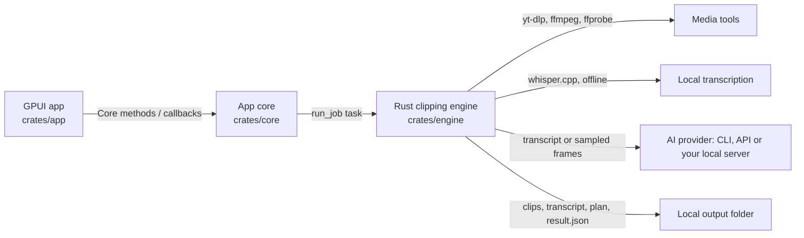

# Architecture and data flow

The GPUI app (`crates/app`) draws the UI and does the native parts: file dialogs, opening files and links, window glass, video playback through AVFoundation and voiceover recording. Every operation goes through a `Core` method (`crates/core/src/api.rs`), which validates job options and checks every path before it is read, opened or copied. Saved provider keys never leave the core except to the engine.

Provider keys live in the OS keychain (`keyring`). `settings.json` holds only non-secret settings plus a record of which keys are stored. Only the selected provider's key is passed to the engine for a job. The Local AI server URL, model and image switch are plain settings; they, and its optional key, reach the engine only when Local AI is selected.

Each job runs in-process as a tokio task that calls `clip_engine::pipeline::run_job`. Two jobs run at once and the rest are queued. The engine:

1. **Downloads** a link with yt-dlp (YouTube, Twitch VODs) or a pinned HTTP client (direct links), or uses a local file in place. The source host must resolve to a public address before any request. Direct downloads re-check every redirect and pin the connection to the checked address. yt-dlp resolves its own media URLs, so the pre-launch check is its only network guard.
2. **Transcribes** offline with whisper.cpp (`whisper-rs`). Audio never leaves the machine.
3. **Plans** clips. In manual clip mode (`manualClips` in the job request) the planner and provider are skipped: the user's ranges become the plan as typed (no sentence snapping), clamped to the video, with `planning_source: "manual"`, zero cost and provider `none`; transcription covers only the earliest start to the latest end. Otherwise the plan comes from the chosen provider: a logged-in CLI (text only), OpenRouter, Anthropic or OpenAI, or the user's own OpenAI-compatible server (Local AI: Ollama, LM Studio, llama.cpp, vLLM), which gets the same prompts and receives images only when the user marked the model as accepting them. When there is no speech, sampled frames replace the transcript for providers that accept images. Local AI requests go only to the configured server, skip any proxy for loopback and LAN hosts, and fall back from JSON-schema output to JSON mode to prompt-only JSON when a server refuses the schema.
4. **Analyzes layout** with YuNet face detection (`tract-onnx`) and shot-cut detection, optionally checked by the provider's vision model.
5. **Renders** each clip with FFmpeg: smart framing, pacing cuts, speed, captions (libass) and overlays.

The media tools run with a minimal environment (no provider keys), timeouts, output caps and kill-on-cancel. FFmpeg and ffprobe read untrusted input only through the local-file protocol and container whitelist. The job's work folder, under the app data directory, holds the download and intermediates; the core removes it after every job and sweeps stale work at startup. A local source stays where it is. Finished clips, `transcript.json`, `plan.json` and `result.json` stay in the run folder.

Engine errors carry fixed marker phrases, which `pipeline::describe_failure` maps to a fixed message and hint for the UI. Raw provider output, URLs and paths never reach the UI or the logs. Saved run files are treated as untrusted input when the Library loads them.

The planned supported release builds are macOS Apple silicon and Intel. Windows and Linux source builds work but are not part of the release workflow yet.
